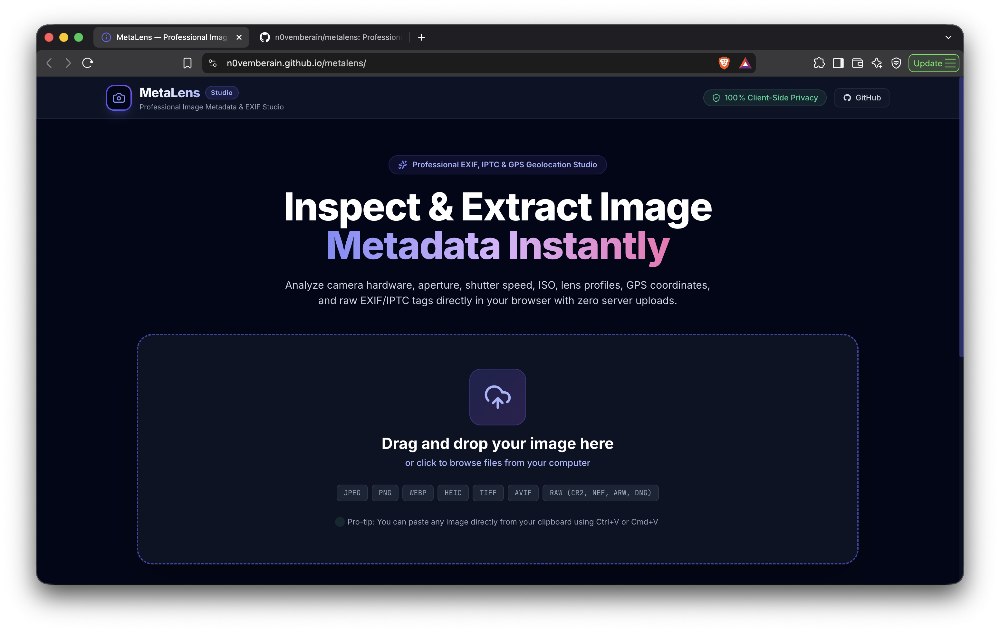
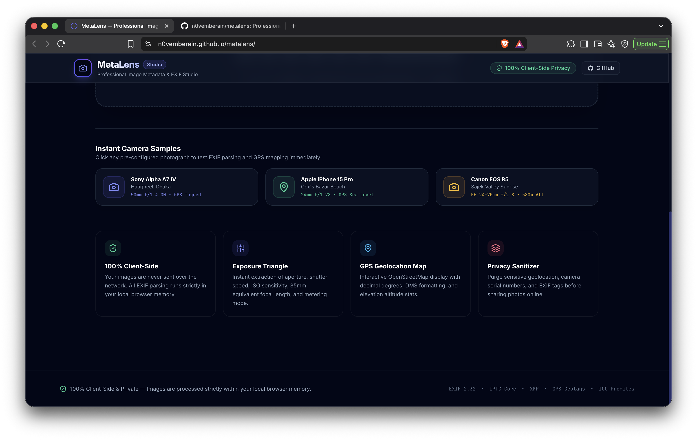

# MetaLens — Professional Image Metadata & EXIF Studio

> A high-performance, privacy-first, client-side web application designed to extract, analyze, visualize, and sanitize image metadata (EXIF, GPS, IPTC, XMP, ICC, and Camera Settings) directly in your browser.

---

> [!TIP]
> ## Live Application
> # **[https://n0vemberain.github.io/metalens/](https://n0vemberain.github.io/metalens/)**
>
> **Click above to try MetaLens live directly in your browser.**  
> *Zero setup required • 100% Client-Side & Private • No images uploaded to any server.*

> [!NOTE]
> ## Android APK Download
> # **[Download MetaLens.apk (v1.0.0)](https://github.com/n0vemberain/metalens/releases/download/v1.0.0/MetaLens.apk)**
>
> **Direct standalone APK package (4.5 MB) ready to install on Android.**  
> *Supports Android 7.0 through Android 15 • 100% Offline • Complete privacy.*

[](https://n0vemberain.github.io/metalens/)
[](https://github.com/n0vemberain/metalens/releases/download/v1.0.0/MetaLens.apk)
[](https://react.dev/)
[](https://capacitorjs.com/)
[](https://vite.dev/)
[](https://tailwindcss.com/)
[](https://leafletjs.com/)
[](LICENSE)

---

## Application Preview



<br />



---

## Features

### 1. 100% Client-Side & Privacy-First
- **Zero Server Uploads**: Every byte of your image is parsed strictly inside your local browser memory using modern web APIs (`FileReader`, `ArrayBuffer`, and HTML5 Canvas).
- Your private photos, location data, camera serial numbers, and personal tags **never leave your device**.

### 2. Studio Workbench Architecture
- **Responsive Two-Column Layout**: A dedicated sticky visual inspector on the left paired with a multi-tab analytical workbench on the right.
- High-resolution image preview with click-to-expand lightbox, instant exposure summary dials, and quick metadata chips.

### 3. Camera & Exposure Dashboard
- **Camera & Lens Gear**: Camera Make, Model, Lens Model, Lens Make, and Firmware version.
- **Exposure Diagnostics**:
  - Aperture ($f$-stop)
  - Shutter Speed (Exposure Time)
  - ISO Sensitivity
  - Focal Length & 35mm Equivalent
  - Exposure Program (Manual, Aperture Priority, Shutter Priority, etc.)
  - Metering Mode (Multi-segment, Spot, Center-weighted)
  - Flash Status (Fired, Did not fire, Auto)
  - White Balance & Exposure Compensation (EV Bias)

### 4. Geolocation & Interactive Map
- Automatic extraction of GPS coordinates (Decimal Degrees and DMS format: `23° 46' 20" N`).
- Altitude calculation (meters and feet above sea level).
- **Interactive OpenStreetMap / Leaflet map** with custom marker and coordinates popup.
- One-click links to open location in **Google Maps** or **OpenStreetMap**.
- One-click GPS coordinates copy.

### 5. File & Display Specifications
- Real pixel dimensions (Width × Height) and Megapixel (MP) calculation.
- Aspect Ratio recognition ($16:9, 4:3, 3:2, 1:1$, etc.).
- **Print Size Estimator**: Calculates exact physical dimensions in inches and centimeters for 300 DPI (Fine Art), 240 DPI (Editorial), and 150 DPI (Poster) output.
- Color Space (sRGB, Adobe RGB, Display P3) and Bit Depth.

### 6. Creator & Copyright Information
- Photographer / Artist name (IPTC/EXIF by-line).
- Copyright notices and image descriptions / captions.
- Editing software detection (e.g. Adobe Photoshop, Lightroom, Capture One).

### 7. Searchable Raw Tags Inspector
- Live instant search across hundreds of raw metadata tags and descriptions.
- Filter by tag groups: `EXIF`, `GPS`, `IPTC`, `XMP`, `ICC`, `FILE`.
- Copy individual tag values or entire tag blocks with a single click.
- Filtered table JSON export capability.

### 8. Privacy Sanitizer (Metadata Stripper)
- Download a sanitized version of the image with all EXIF, GPS coordinates, and camera information stripped.
- Choose between JPEG (with customizable compression quality) or lossless PNG.

### 9. Export Options
- Export complete metadata structure as a neatly formatted `.json` file.
- One-click copy of the key technical summary to your clipboard.

### 10. Seamless Input Options
- **Drag & Drop** file zone.
- Traditional file browser.
- **Clipboard Paste (`Ctrl+V` / `Cmd+V`)**: Paste images directly from screenshots or web pages.
- **Pre-loaded Sample Photos**: Test immediately with pre-configured sample photos (Sony Alpha A7 IV, Apple iPhone 15 Pro, and Canon EOS R5).

---

## Supported Formats

- **JPEG / JPG** (`.jpg`, `.jpeg`)
- **PNG** (`.png`)
- **WebP** (`.webp`)
- **TIFF / TIF** (`.tiff`, `.tif`)
- **HEIC / HEIF** (`.heic`, `.heif`)
- **AVIF** (`.avif`)
- **RAW Camera Formats**: Canon (`.cr2`, `.cr3`), Nikon (`.nef`), Sony (`.arw`), Adobe DNG (`.dng`), and Fujifilm (`.raf`).

---

## Quick Start & Local Setup

### Prerequisites
- Node.js (v18.0.0 or higher recommended)
- npm, yarn, or pnpm

### Installation

```bash
# 1. Clone the repository
git clone https://github.com/n0vemberain/metalens.git

# 2. Navigate to the project directory
cd metalens

# 3. Install dependencies
npm install

# 4. Start the development server
npm run dev
```

Visit `http://localhost:5173` in your browser.

### Building for Production

```bash
# Build optimized production bundle
npm run build

# Preview production build locally
npm run preview
```

### Building for Android (APK)

```bash
# 1. Build web bundle and sync with native Android project
npm run build
npx cap sync android

# 2. Compile native Android debug APK
cd android
./gradlew assembleDebug

# The compiled APK will be located at:
# android/app/build/outputs/apk/debug/app-debug.apk
```

---

## Tech Stack

- **Framework**: [React 18](https://react.dev/)
- **Mobile Engine**: [Capacitor 7](https://capacitorjs.com/)
- **Build Tool**: [Vite 6](https://vite.dev/)
- **Styling**: [Tailwind CSS 3.4](https://tailwindcss.com/)
- **Icons**: [Lucide React](https://lucide.dev/)
- **Metadata Engine**: [ExifReader](https://github.com/mattiasw/ExifReader)
- **Map & Geolocation**: [Leaflet](https://leafletjs.com/) & OpenStreetMap
- **Typography**: Google Fonts (*Inter*, *JetBrains Mono*)

---

## License

This project is licensed under the [MIT License](LICENSE).
